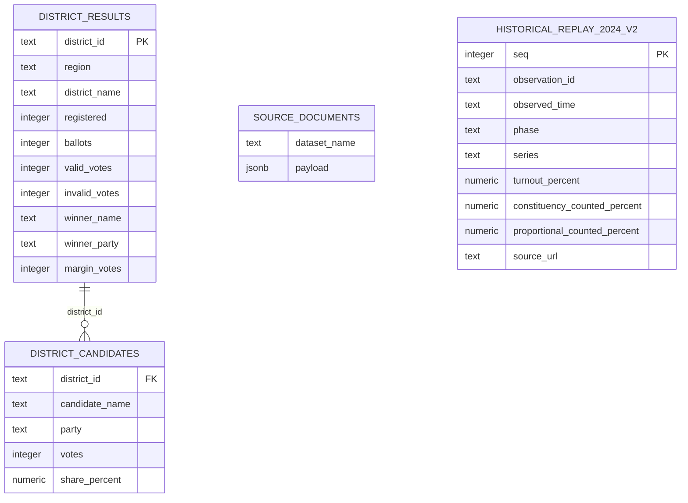

# 제22대 총선 V5 데이터 구조 · ERD 및 데이터 사전

## 실제 저장소
기존 PostgreSQL 스키마: `election_lab`. 이 문서는 **현재 코드의 논리 관계 설명**이며 DB 테이블 변경을 지시하지 않는다.

## 파생 화면 계산
| 출력 | 근거 필드 | 계산/주의 |
|---|---|---|
| 지역구 당선 | `district_results.winner_name, winner_party` | 선관위 최종 자료 |
| 후보별 득표수·득표율 | `district_candidates.votes, share_percent` | 개별 지역구 후보 단위 |
| 지역구 투표율 | `ballots / registered × 100` | 선거인수>0, 0≤투표수≤선거인수 |
| 시·도 전체 투표율 | 검증된 선관위 `turnout` 자료 | 지역구 결과 평균값으로 대체하지 않음 |
| 지역구 도넛 | `constituency.seats_by_party` | 합계 정확히 254석 |
| 비례 도넛 | `proportional.seat_allocation` | 합계 정확히 46석 |
| 300석 반원 | 지역구 + 비례 정당별 합계 | 합계 300석; 법적 정당명을 임의 통합하지 않음 |
| 지역구 지도 | `newsroom/static/map_22nd_2024.geojson` | 254개 지역구 ID와 DB ID 1:1 대조 |
| 시군 목록 | 국회의원 선거구 이름의 시·군·구 문자열 | **탐색 편의용 분류**, 공식 시군 행정경계 아님 |
| 시간별 투표율 | `historical_replay_2024_v2` | 41개 검증된 당시 관측 시각, 추정치 미생성 |

기존 `election_lab`에는 비례대표 지역별 정당 득표와 선관위 보고서 출처 문서도 있다. 물리 ERD 및 원본 설계는 기존 `docs/ERD_ACTUAL_V11.svg`, `docs/ERD_TARGET_V11.svg`, `newsroom/docs/ERD_AND_SCHEMA_V07.md` 참조.

## 자료 혼용 방지
- 총투표율 67.0%는 실제 최종 집계. 67.2%는 전체 선거인 표본조사 수치로 별개.
- 개표 시각 10:25는 당시 보도 기반 재생 라벨이지 선관위 인증 업무 종료시각은 아니다.
- 최종 후보별 개표자료를 시간별 중간 후보 데이터처럼 재사용하지 않는다.
