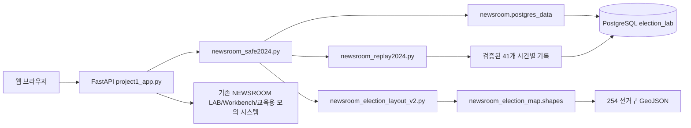

# V5 시스템 아키텍처 · 2026-11-24 추가 설계

## 구성도

## 데이터 흐름
1. 선관위 최종 선거자료 → `election_lab` 원본과 개표/투표율 파생 객체.
2. `real_api.vote_data()` 및 `real_api.turnout()` → 254개 지역구 및 전국 정당별 의석 계산.
3. `geometry_svg`가 254개 ID를 실제 지도 경계와 대조하고 SVG 생성.
4. `nationwide_overview`는 정적 전국 요약 지도와 254/46/300석 그래프만 출력.
5. `district_explorer`는 지역구 이름에서 시·군·구 탐색 인덱스를 만들고 지도·후보 카드·투표율 계산.
6. `replay_html`은 41개 확인 시점을 시간별 재생하며 13시 주석은 검증된 해당 관측 시점에만 표시.
7. 지역구·비례 모두 100%인 마지막 보도 기준 시점에서만 `/safe2024/final-embed`를 요청해 확정 전국 결과 표시.

## 원본 보존 원칙
- PostgreSQL 기존 원본 테이블 및 교육용 모의 집계를 삭제하지 않는다.
- V5의 새로운 화면 모듈은 기존 `newsroom_election_map.py`의 실제 지리경계 함수를 재사용한다.
- 기존 RAG·기사 승인·모의 화면·Workbench는 원래 경로에 유지한다.
- 본 개발은 대체 URL 및 화면 함수 통합이며 데이터 원본의 수정·재수집 작업이 아니다.

## 검증 한계
CI와 최종 사용자 Windows에 있는 psycopg DLL·DB 접속은 별개. 사용자의 Windows 환경에서 실제 기능별 접속 검증이 완료돼야 운영 정상 판단이 가능하다.
