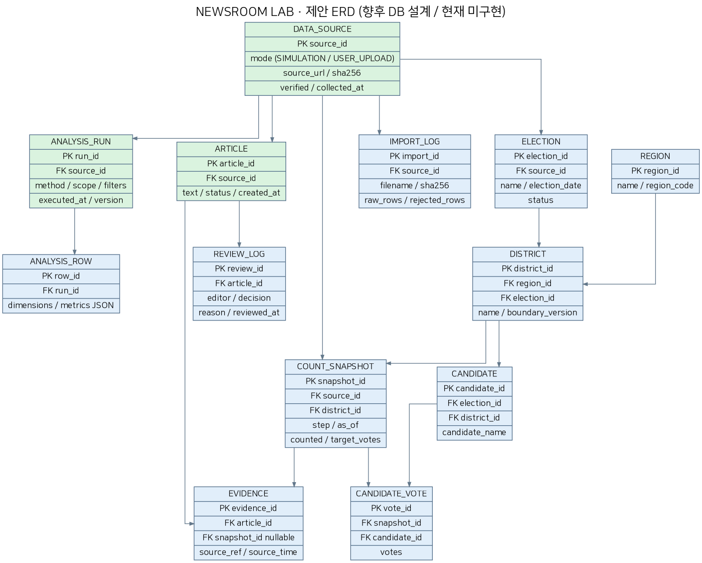
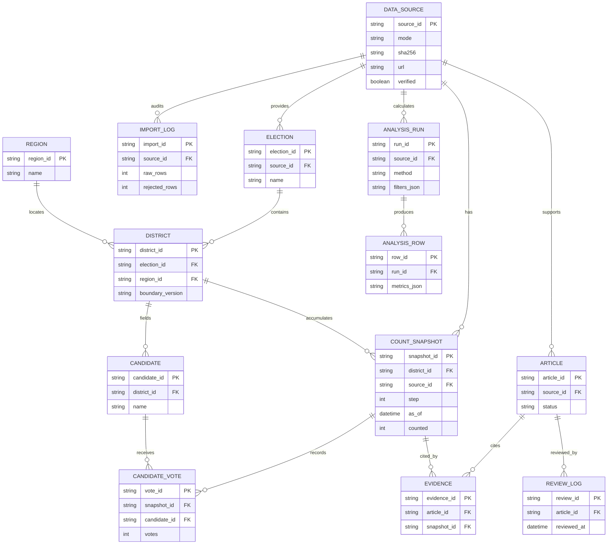

# ERD: 현재 구현과 향후 데이터베이스 설계 구분

**중요:** 현재 V0.7은 SQL/SQLite/PostgreSQL 테이블을 생성하지 않습니다. 선거 데이터와 기사·검수 기록은 **Python `server.py`의 메모리(`state`, `official_store`)**에만 있습니다. 아래 ERD는 **추가 구현을 위한 제안 논리 모델**입니다.

## 1. 현재 코드의 실제 자료 구조

| 저장 위치 / 코드 | 실체 | 수명 | 연결 |
|---|---|---|---|
| `engine.py:generate()` | 17개 시도, 254개 가상 선거구와 A/B/C 모의 표 | 난수 생성 후 메모리 | `server.py:state['districts']` |
| `server.py:state` | `districts`, `step`, `running`, `interval`, `history`, `articles`, `audit` | 서버 종료/재시작 시 초기화 | `/api/snapshot`, `/api/analytics`, `/ws`, `/api/articles` |
| `analytics.py:compact_history()` | 단계·시각별 전국/시도/선거구 `counted`,`progress_pct`,`votes` | 최대 121개 단계 | `/api/analytics` 8종 그래프의 이력 |
| `official_results.py:parse_csv()` | 사용자 업로드 CSV의 선거구·후보별 득표 합계, SHA-256, 출처 메타데이터 | 메모리에서 한 건만 관리 | `server.py:official_store`; `/api/official/analyze` 12종 |
| `training_pipeline.py` | 본문·제목·출처·검수 상태·JSONL 출력 | API 요청 응답 위주 | `/api/training/*` |
| `server.py:state['articles']` | 교육용 기사 텍스트, 원본 스냅샷 근거, 검증/승인 정보 | 서버 메모리 | `/api/articles/*`, `/api/audit` |

## 2. 제안 정규화 ERD

### 필수 제약 조건
- **자료 분리:** `mode`는 `SIMULATION_ONLY`, `SYNTHETIC_SAMPLE_NOT_OFFICIAL`, `USER_UPLOADED_FINAL_RESULT` 등으로 분리. 서로 다른 출처 집계는 교차 합산 금지.
- **유일성:** `(source_id, district_id, step, as_of)`와 `(snapshot_id, candidate_id)` 중복 금지. 원본 투표구 데이터를 저장할 경우 `(source_id, 시도, 선거구, 읍면동, 투표구, 후보)` 키로 중복 방지.
- **수치 제약:** 모든 득표수 ≥ 0; 선거구 스냅샷의 후보 득표 합계 = 집계 표수. 사용자 CSV의 선거인수/투표수/무효투표수는 후보가 아님.
- **출처 추적:** 공식 URL 입력만으로 `verified=true`가 되지 않으며 원본 대조 담당자·시각·검증 기록이 있어야 함.
- **시간:** 기준 시각과 수집 시각을 구분하고 Asia/Seoul 화면 변환 로직을 보존. 모의 `step`은 실제 선거 당시 개표 시각이 아님.
- **집계:** 후보 개인 표는 선거구 내에만 비교. 같은 이름의 다른 선거구 후보를 한 사람으로 자동 합산하지 않음.
- **기사 승인:** 근거 ID/원본 수치 불일치 시 최종 승인 차단. 승인 정보는 사용자 인증·감사 DB 도입 전에는 교육용 참고치로만 사용.

> 다음 단계의 실제 DB 생성/마이그레이션은 아직 하지 않았습니다. 기존 기능을 유지하면서 별도 개발·검증 후 결정해야 합니다.
