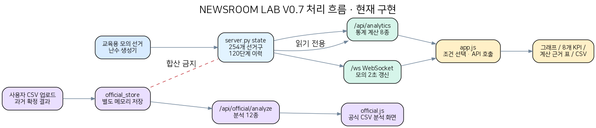

# NEWSROOM LAB V0.7 전체 처리 흐름 및 검수

## 오류 원인
V0.6 HTML에는 통계 선택 필드와 결과 영역이 있었고 서버에는 `/api/analytics`와 8개 계산 함수가 있었으나, `static/app.js`에서 `statScope`,`statMethod`,`statRefresh` 이벤트 바인딩 및 렌더링 처리가 빠졌습니다. 또한 `style.css`에서 `.stat-*` 스타일이 빠져 선택 메뉴가 한 줄로 붙었습니다.

## 수정한 연결
`시뮬레이션 엔진 (state/history)` → `analytics.py` → `GET /api/analytics?scope&method&window&region&district_id` → `app.js:refreshStatistics()` → `renderStatisticsChart()/renderStatisticsReport()` → 그래프·8개 요약 통계·실제 계산 행 테이블. `GET /api/analytics/export.csv`는 현재 선택 조건으로 원본 계산 행 다운로드.

WebSocket `/ws`에서 모의 스냅샷을 받으면 통계 화면이 열려 있을 때 새 API 결과를 요청합니다. 경합 시 이전 요청 응답은 버리고 최신 결과만 그립니다.

## 상태별 검증
- 기본 전국: A/B/C 득표 막대 3개, 8개 KPI, 데이터표 3행.
- 지역 개표율: 17개 시도 막대, 데이터표 17행.
- 격차: 254개 모의 선거구 순위 계산; 그래프 상위 20개, 표 처음 40개.
- 구간별 개표율: 10개 히스토그램 구간.
- 시간별 개표율: 초기 데이터 7단계(0~6) 꺾은선; 초기화하면 1단계부터 다시.
- 후보별 누적 득표: 3개 추이선.
- 단계별 추가 표수: 2단계 이상 필요; 초기화 직후 부족 시 안내.
- 산점도: 선거구별 개표율·1/2위 격차 좌표.
- 시도/선거구 선택: 서울/서울-001 등 조건 유효성 검사, 다른 지역의 선거구 혼합 시 API 400.
- 공식 결과 CSV 분석: 별도 `official_store`, 12개 분석기법, 출처 미검증. 모의 수치와 합산 금지.
- 기사·RAG 검색·승인: 기존 모듈 그대로 유지. 키워드 근거 검색이지 벡터 RAG 아님.
- 학습데이터: 기존 로컬 HTML/CSV 정제와 검수형 JSONL 출력 유지. 자동 크롤링·파인튜닝 없음.

## 검증 유형
1. Python `pytest`: **60개 통과**, 기존 54개 + 신규 6개.
2. `node --check static/app.js`: JavaScript 구문 통과.
3. 브라우저 DOM 시험: **실제 FastAPI TestClient JSON을 네트워크 모의 계층으로 전달**해 8기법, 전국/서울/서울-001, 그래프 요소/8개 카드/표를 검증. JavaScript 예외 0건.
4. 직접 HTTP API: `curl localhost` 응답 200 확인. 단, 브라우저 직접 로컬 URL 접근은 환경의 관리자 보안 차단으로 불가. 따라서 **Windows 11 실기기 표시 검증은 미완료**.

## 남은 위험·작업
- 서버는 메모리 기반이며 종료 시 통계 이력·승인 기록이 사라집니다. SQLite/PostgreSQL 설계는 ERD 제안만 마련했으며 구현하지 않았습니다.
- 최종 실제 자료의 신뢰성은 사용자가 올린 CSV 출처만 입력해도 보장되지 않습니다. 공식 원본 대조, 선거구 코드 매핑, 게시 시점/이용 조건 확인 기능 추가 필요.
- WebSocket 연결 끊김/재연결은 있지만 동시 사용자 충돌/동기화 지연·서버 장애 고가용성 시험은 아직 미완료.
- 선거 자료에는 개표 당일 공식 실시간 스트림이 연동되어 있지 않으며, 자동 증가하는 것은 교육용 난수뿐입니다.
- 현행 사진/CG 영역은 기존 기능 보존 차원에서 남김. 이번 패키지에서 새 영상/CG를 제작하지 않았습니다.
- Windows Defender/SmartScreen·회사 보안 정책은 실행환경에 따라 배치파일을 제한할 수 있습니다. 패키지는 로컬용입니다.
