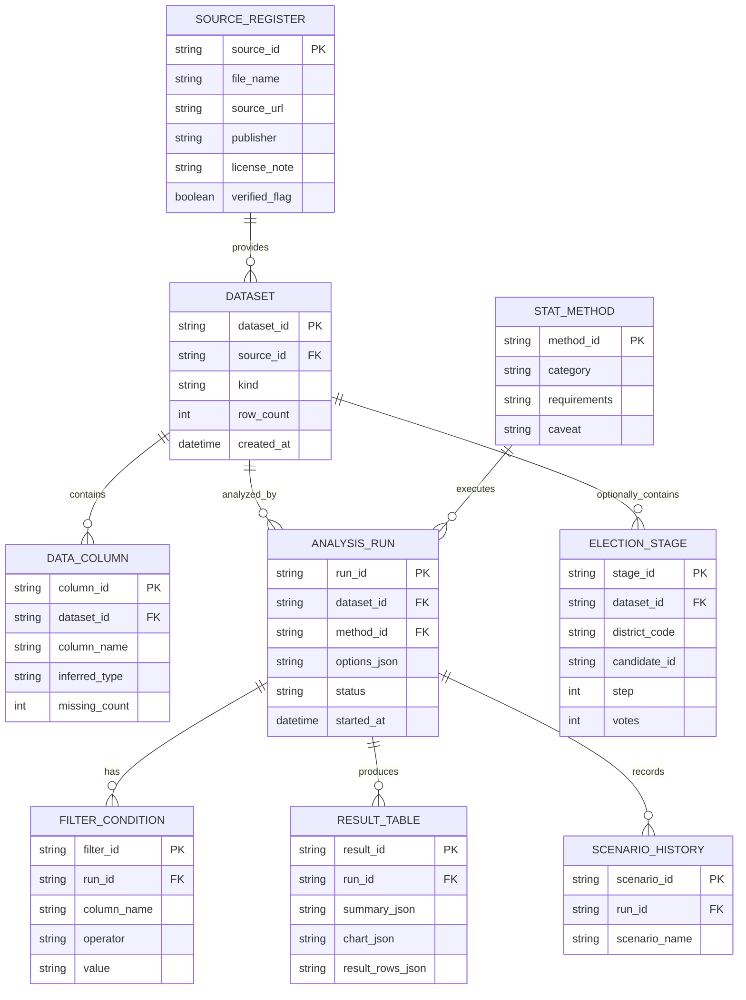

# 데이터 관계 설계 (ERD) 및 현재 상태

**현재 V1.0은 DB를 쓰지 않습니다.** 아래는 SQLite/PostgreSQL의 영속 저장 및 RAG/뉴스 검수 연계를 위한 **제안 ERD**입니다. 동작 중 데이터는 서버 프로세스의 메모리에만 있고 재시작하면 초기화됩니다.

## 핵심 원칙
1. 업로드 원본과 정제 데이터는 분리 저장한다. 버전/체크섬 기록을 도입한다.
2. `ANALYSIS_RUN`의 실행 조건/기법 버전/결과 생성시각을 기록하면 그래프와 표를 재현할 수 있다.
3. 선거는 후보·지역·선거구·단계의 고유 키를 정하고 **정당별/후보별 표와 집계 항목을 분리**해야 한다.
4. 기사/RAG/팩트체크/사람 승인은 `EVIDENCE`, `ARTICLE`, `APPROVAL_AUDIT`를 별도 테이블로 만들되 현재 MVP에서는 미연동.
5. 권한 관리/인증·개인정보 비식별화·영속 로그 백업 후에만 외부 공개를 검토한다.

## 현행 메모리 키
- `DATASETS[dataset_id]` → `{name,kind,source,source_url,origin,at,df,history}`
- `df`는 사용자 업로드 원본을 읽은 `pandas.DataFrame`; 계산 엔진은 복사본을 이용.
- `history[]`는 최근 20회 기법명·필터·옵션·요약·시각; 원본 데이터 자체는 포함하지 않음.
