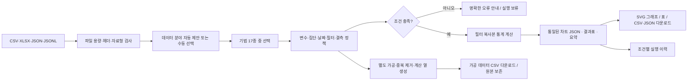

# 시스템 처리 흐름

## 단계별 QA 포인트
- 업로드 시 12MiB·50,000행·120열 제한과 잘못된 헤더 검사.
- 선택 기법에 필요한 수치·범주·날짜열이 없으면 차단.
- 같은 입력 데이터에서 필터 변경→다시 실행하면 원본의 행 수는 변하지 않음.
- `구간·이동평균 창·집단수·군집수` 등 조건을 바꿔 재계산.
- 반환 결과는 요약, 열, 표 행, 차트, 경고를 동시에 담음.
- 브라우저는 API JSON을 이용해 그래프를 그리며, 모든 방법은 표도 표시.
- 외부 인터넷/실시간 선거 API/예측 AI는 연결하지 않음.
